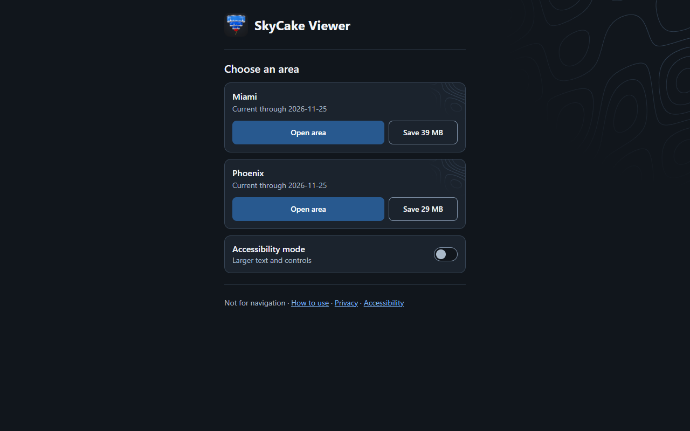
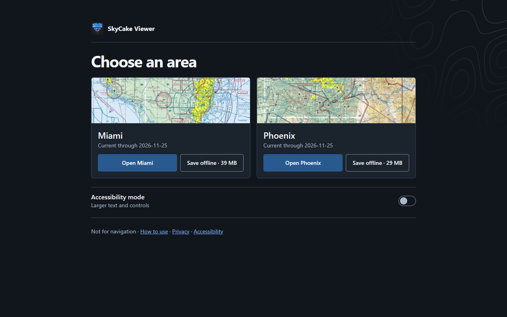
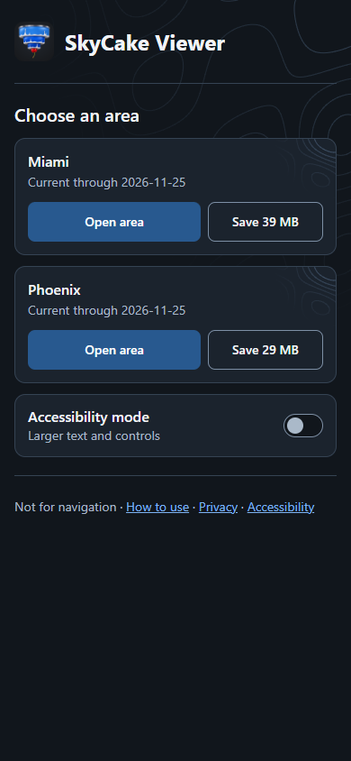
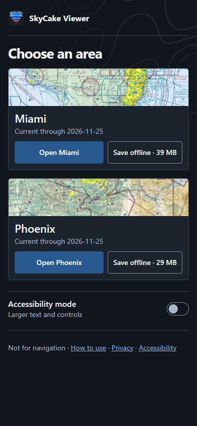
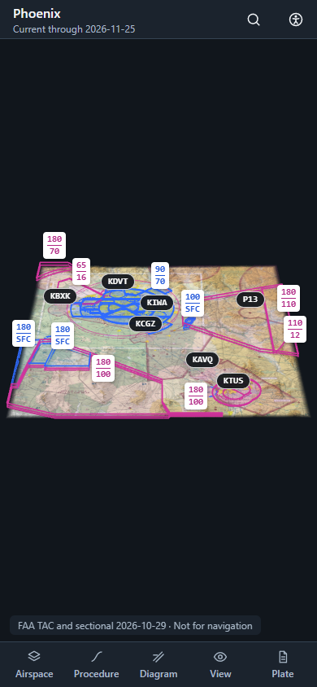
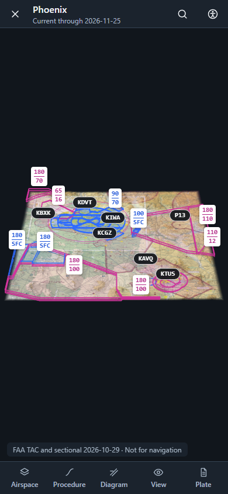
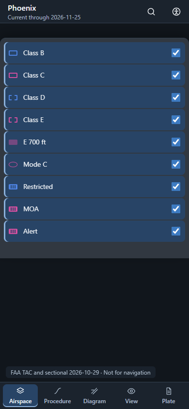
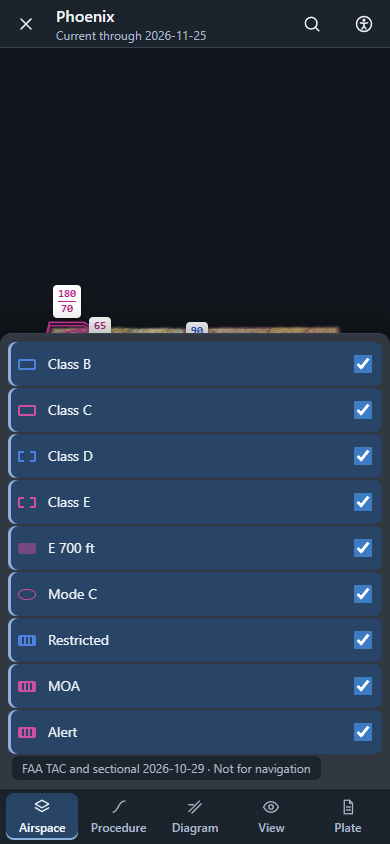

# SkyCake UI audit

Reviewed November 19, 2026, starting at `3c21590`. The installable mobile viewer and standalone web viewer share the PWA in `app/`. Captures use the running build in Chromium at 1280 × 800 and 390 × 844 CSS pixels. The narrow viewport retains a fine pointer, which matters for the Close finding. Screenshots below use Phoenix and the bundled chart edition.

## Findings in impact order

| Impact | Flow and evidence | Observation and consequence |
| --- | --- | --- |
| High | 1. Open an area | During chart initialization the page showed a dark field and the chart credit for several seconds. The shell fetch and map mount had no visible failure recovery. A first-time or offline visitor could mistake loading for a broken viewer. |
| High | 2. Return to areas · [phone map](docs/ui-audit/before-phone-map.png) | Desktop Close lives in the tool rail. Narrow layout hides that rail, while JavaScript gates the Close tab on a coarse pointer. Narrow mouse and keyboard users lose the in-app exit. On touch, Close is last in a potentially scrolling tool list. |
| High | 3. Raise airspace · [phone sheet](docs/ui-audit/before-phone-airspace.png) | With an area title present, a desktop top offset wins over the mobile bottom-sheet rule. The list covers the chart while leaving an empty strip down to the tab that opened it. The invisible positioning container also spans much of the map. |
| Medium | 4. Choose and save an area · [desktop](docs/ui-audit/before-desktop.png) · [phone](docs/ui-audit/before-phone.png) | A 448 px content column gives the desktop the same stacked layout as a phone. The product name outweighs the task, the two blue actions have identical visible labels, and Save gives bytes without identifying the offline purpose. The accessibility switch looks like a third area card. |
| Medium | 5. Find a procedure and read a plate · [search](docs/ui-audit/phone-search.png) · [phone split](docs/ui-audit/phone-plate.png) · [desktop split](docs/ui-audit/desktop-plate.png) | Airport IDs scan well, but text identifying each airport is small beside its ID. Search and Procedure enter the same picker with different labels. Split keeps context and the plate can be enlarged. At phone size the initial plate is too small to read without zooming. |
| Lower | 6. Learn with the embedded player | Walkthroughs and quizzes have separate demo entry points. Production lesson content and labels belong to the host. The standalone chooser gives no route to these modes. Decide whether they belong in this app before adding navigation. |

## Status on this branch

| Finding | Status |
| --- | --- |
| 1. Open an area | Done. The shell names the chart while it loads, and a failed manifest or chart load shows Try again (plus Choose an area for a chart). |
| 2. Return to areas | Done. Close sits at the leading edge of the phone header for touch and mouse alike, and is no longer a tab. |
| 3. Raise airspace | Done. The desktop offset under the area card applies only above 860 px, so the phone sheet sits on its tab bar. |
| 4. Choose and save an area | Done. Chart previews, side by side on desktop, Open Miami / Open Phoenix, Save offline with its size, and the accessibility switch as a plain row. |
| 5. Find a procedure and read a plate | Done for airport names: 14 px like the ID, in the brighter text color, in a fixed ID column. Split as the first phone plate view and the two entries to the picker are kept by decision (below). |
| 6. Learn with the embedded player | Kept by decision: lessons stay on the host sites. |
| States: empty list, bare Retry | Done. An empty manifest says No areas available; a failed save says Retry download and names its area to screen readers. |

`src/style.test.ts` checks the stylesheet rules these fixes depend on.

## Accessibility and states

The existing system typeface, reserved chart colors, visible focus styles, 44 px control rows, higher-contrast accessibility mode and reduced-motion contours are worth keeping. The phone header has little room for extra controls. Preserve one reachable exit without increasing the number of tabs. The chart attribution needs to stay legible over the map and sheets. The initial chooser has no empty-list message. Save exposes progress, completion and retry, though a bare Retry does not explain which operation failed.

## Scope

These captures assess viewport layout and interaction. Installed iOS/Android behavior, screen-reader announcements, physical touch, field sunlight and sustained low-end GPU performance require device testing.

## Changes verified on this branch

| Flow | Before | After |
| --- | --- | --- |
| Desktop area chooser |  |  |
| Phone area chooser |  |  |
| Phone map navigation |  |  |
| Phone Airspace |  |  |

The chart crops come from the bundled FAA sectionals and add about 90 KB total to the offline shell. The chart date and file size stay visible before opening or saving. System typography and the existing blue selection color carry through to the map. On narrow screens the area actions stack if needed. At 320 px with larger controls enabled, the chooser fit without horizontal overflow.

- Saved Miami and observed the completed [offline state](docs/ui-audit/phone-saved.png).
- Blocked the Phoenix area-data request, observed the [recovery screen](docs/ui-audit/phone-error.png), restored the request and reopened the chart with Try again. The shell now reports loading before the map is ready.
- Opened Airspace at 390 × 844. Its bottom and the top of the tab bar both landed at y = 788. Used Enter on the 44 px header Close control to return to the chooser.
- Loaded the embedded [walkthrough](docs/ui-audit/walkthrough.png) and [quiz](docs/ui-audit/quiz.png). Both showed the supplied draft lesson labels. The quiz screenshot includes the scrollable page below the initial phone viewport.
- Search already has a no-matches message. A valid empty area manifest now gets its own message. Physical-device assistive technology and storage eviction remain unverified.

## Decisions for Chris

Chris chose to keep the current behavior for all three: lessons stay on the host sites, phone plates open in Split, and both the header search and the Procedure tab stay.

1. Keep lessons on the host sites, or give the standalone viewer a lesson entry point? The current draft keeps the viewer focused on exploring areas.
2. Keep Split as the initial plate view on phones, or open the plate full-screen? Split preserves map context, while full-screen gives a more legible first look.
3. Keep both the header search shortcut and the Procedure tab, or consolidate them? Both currently open the same picker. Consolidation needs a decision about which location should own search.
